# YFIT screen index — all 11 saved assets

Original 1080 × 1920 images use the real app colors and fictional demonstration data. Thumbnails below are reduced copies only; the full PNGs are unchanged. Four images are online; the seven others are prepared but still need owner-dashboard upload. See [the restoration guide](README.md).

## 01. Dashboard

[Open the full image](pages/screen_01_dashboard.png) · **Online and unchanged**

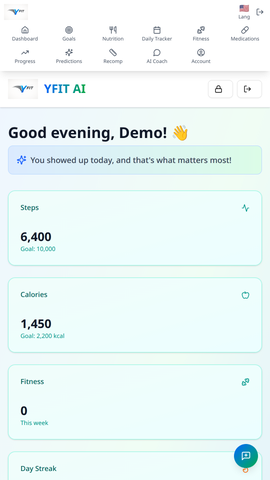

Preserved approved original; actual dashboard with fictional sample records.

## 02. Goals

[Open the full image](pages/screen_02_goals.png) · **Prepared; upload required**

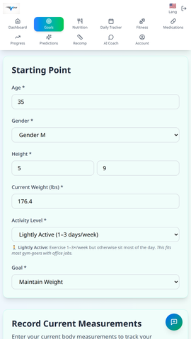

Actual Starting Point manual-entry form; fictional imperial profile. Title and lower measurements are outside this viewport. No calculated/saved result.

## 03. Nutrition

[Open the full image](pages/screen_03_nutrition.png) · **Prepared; upload required**

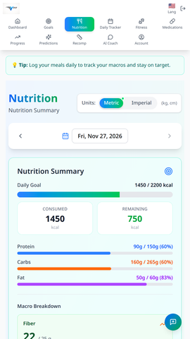

Actual calorie/macronutrient progress overview with fictional meal records; logged-meals detail remains in the prior review evidence.

## 04. Daily Tracker

[Open the full image](pages/screen_04_dailyTracker.png) · **Prepared; upload required**

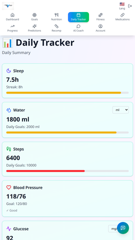

Actual daily-entry overview with fictional sample records; not a saved-action recording or verified health advice.

## 05. Fitness

[Open the full image](pages/screen_05_fitness.png) · **Online and unchanged**

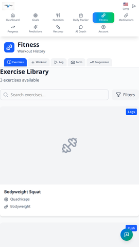

Preserved approved original; actual authenticated Fitness interface, not guest History layout.

## 06. Medications

[Open the full image](pages/screen_06_medications.png) · **Online and unchanged**

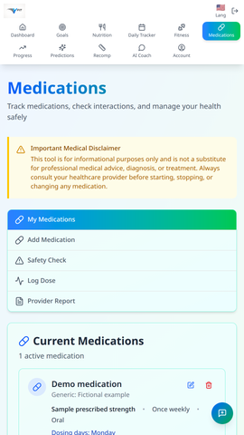

Preserved approved original; fictional medication records, not clinical recommendations.

## 07. Progress

[Open the full image](pages/screen_07_progress.png) · **Prepared; upload required**

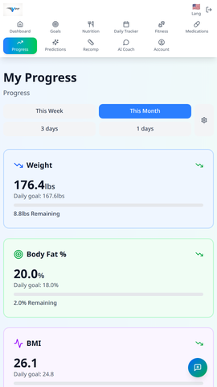

Actual overview with identical fictional starting/current weight and body fat; no invented improvement. Native 3 days/1 days period labels and pounds unit remain unchanged; lower BMI row/history is outside view.

## 08. Predictions

[Open the full image](pages/screen_08_predictions.png) · **Prepared; upload required**

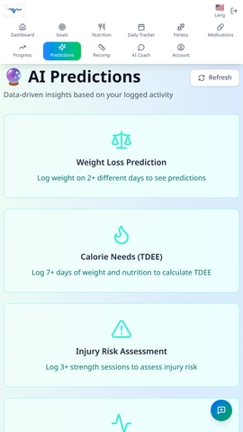

Genuine insufficient-data overview; no generated forecast, model output or demonstrated injury prediction. Native AI/TDEE/injury-risk copy is not independently validated.

## 09. Recomp

[Open the full image](pages/screen_09_recomp.png) · **Prepared; upload required**

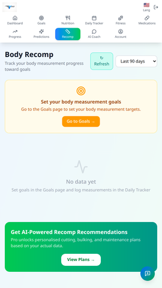

Genuine setup/no-history state; no invented recomposition results or recommendations. Native low-contrast empty text and promotional card are preserved.

## 10. AI Coach

[Open the full image](pages/screen_10_aiCoach.png) · **Online and unchanged**

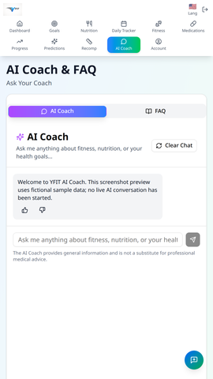

Preserved approved original; genuine visual interface, not evidence of an AI response or health outcome.

## 11. Language menu

[Open the full image](pages/screen_11_language.png) · **Prepared; upload required**

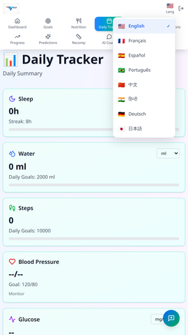

Actual eight-option header language menu over empty Daily Tracker; English selected. Not a standalone route or proof of complete/persistent translations; native Streak: 8h text is not an achieved streak.

